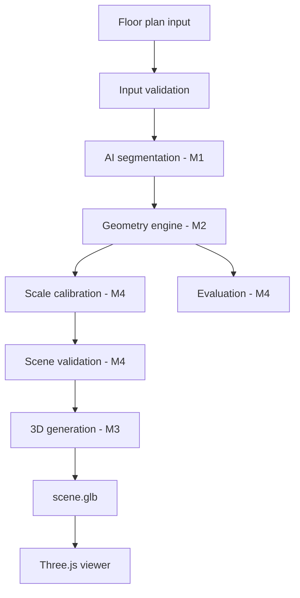

# HNX26EPS06 — Member 4 Implementation Spec (for Antigravity)

**Project:** 3D Scene Generation from Blueprints and Room Video
**Chosen mode:** Mode A — Floor Plan → 3D Model (GLB)
**Role:** Member 4 — Integration + Scale + Validation + Baseline + Evaluation + Release
**Time limit:** 24 hours

> **Instruction to the coding agent:** Implement every section below in order. After each section, run the code, show the output, and fix errors before moving on. Show all code inline in the chat. Do not edit teammates' folders (`ai/`, `geometry/`, `reconstruction/`, `viewer/`). Never fabricate metrics or ground truth.

---

## 0. Context

### 0.1 Judging (Mode A)

| Criterion | Weight |
|---|---:|
| Layout accuracy vs. baseline | 40% |
| Completeness | 15% |
| Model quality | 15% |
| 3D viewer usability | 10% |
| Research contribution | 20% |

Correct geometry matters more than fancy graphics. The research contribution is a **geometry-aware reconstruction layer** (topology correction, wall continuity, door/window-to-wall association, scale calibration, validation) that must **measurably beat a naive baseline on held-out plans**.

### 0.2 Team split

| Member | Owns | Interface provided |
|---|---|---|
| 1 | AI segmentation | `analyze_floorplan(path) -> {wall_mask, door_mask, window_mask, floor_mask}` |
| 2 | Geometry / CV | `reconstruct_geometry(masks) -> scene dict` |
| 3 | 3D + viewer | `generate_3d(scene) -> path to scene.glb` |
| **4 (me)** | Integration, scale, validation, baseline, evaluation, release | everything in this spec |

### 0.3 Golden rule

**Never wait for teammates.** Build stubs for all three interfaces. The pipeline tries the real modules first and falls back to stubs, logging which one is active.

### 0.4 Priorities

```text
P0  Integration, end-to-end pipeline, GLB generation, viewer loads it
P1  Scale, validation, baseline
P2  Held-out evaluation, ablation, research graphs
P3  Fancy UI, advanced OCR, extras
```

Never sacrifice P0 for P3. If the full pipeline doesn't run end to end by hour 7, stop adding features and fix integration only.

### 0.5 Architecture

```text
INPUT → PREPROCESS → AI (M1) → GEOMETRY (M2) → SCALE (M4) → VALIDATION (M4) → 3D (M3) → GLB → VIEWER
                                                                                  │
                                                          EVALUATION (M4) ←───────┘
```

---

## 1. Repository setup

### 1.1 Structure

```text
hacknex-ps06/
├── ai/                      (Member 1 — do not edit)
├── geometry/                (Member 2 — do not edit)
├── reconstruction/          (Member 3 — do not edit)
├── viewer/                  (Member 3 — do not edit)
├── integration/
│   ├── __init__.py
│   ├── pipeline.py
│   ├── api.py
│   ├── schemas.py
│   ├── config.py
│   ├── validators.py
│   ├── scale.py
│   ├── stubs.py
│   └── adapters.py
├── evaluation/
│   ├── __init__.py
│   ├── baseline.py
│   ├── metrics.py
│   ├── evaluate.py
│   ├── compare.py
│   ├── ablation.py
│   └── results/
├── data/
│   ├── input/
│   ├── development/         plan_01..plan_06
│   ├── heldout/             plan_07..plan_10  (NEVER tune on these)
│   ├── masks/
│   ├── expected/            ground-truth JSON per plan
│   └── demo/                demo_01 (simple), demo_02 (medium), demo_03 (messy)
├── scripts/
│   ├── run_pipeline.py
│   ├── validate_scene.py
│   ├── evaluate_all.py
│   └── backup.py
├── tests/
├── docs/
│   ├── architecture.md
│   ├── evaluation.md
│   └── demo.md
├── scene_schema.json
├── requirements.txt
└── README.md
```

### 1.2 Tasks

- [ ] Create all folders with `__init__.py` where needed.
- [ ] Create git branch `member4-integration`.
- [ ] Create `requirements.txt`:

```text
fastapi
uvicorn
python-multipart
pillow
opencv-python
numpy
shapely
pydantic>=2
jsonschema
matplotlib
pytest
pytesseract
easyocr
pymupdf
trimesh
```

- [ ] Create `.gitignore` (venv, `__pycache__`, `outputs/`, model weights).

---

## 2. Common contract (`scene_schema.json` + `integration/schemas.py`)

This is the most important early task. Members communicate through this JSON format, never through ad-hoc Python objects.

### 2.1 Top-level `scene.json`

```json
{
  "version": "1.0",
  "units": "meters",
  "source": { "filename": "floorplan_01.png" },
  "scale": {
    "value": 0.015,
    "unit": "meters_per_pixel",
    "source": "explicit",
    "confidence": 0.9
  },
  "walls": [],
  "doors": [],
  "windows": [],
  "rooms": []
}
```

`scale.source` ∈ `explicit | reference | estimated`.

### 2.2 Wall

```json
{ "id": "wall_001", "start": [0.0, 0.0], "end": [5.0, 0.0],
  "thickness": 0.20, "height": 3.0, "source": "detected", "confidence": 0.94 }
```

Required: `id, start, end, thickness, height, source, confidence`.

### 2.3 Door

```json
{ "id": "door_001", "wall_id": "wall_004", "position": 0.45,
  "width": 0.90, "height": 2.10, "source": "detected", "confidence": 0.88 }
```

`position` is normalized along the wall: `0.0 = start`, `1.0 = end`.

### 2.4 Window

```json
{ "id": "window_001", "wall_id": "wall_002", "position": 0.65,
  "width": 1.20, "sill_height": 0.90, "height": 1.20,
  "source": "detected", "confidence": 0.91 }
```

### 2.5 Room

```json
{ "id": "room_001", "label": "bedroom",
  "polygon": [[0,0],[4,0],[4,3.5],[0,3.5]],
  "source": "inferred", "confidence": 0.82 }
```

`label` is optional. Never block on OCR room names.

### 2.6 Provenance values (`source` on geometry)

```text
detected   found directly by the AI
inferred   repaired/derived by topology logic (e.g., closed a wall gap)
estimated  not on the plan; default used (e.g., wall height 3.0 m)
```

### 2.7 Tasks

- [ ] Write `scene_schema.json` (JSON Schema draft-07) enforcing the required fields, ranges (`position` in [0,1], `confidence` in [0,1], thickness/height/width > 0), and enums.
- [ ] Write `integration/schemas.py` with pydantic models `Scale, Wall, Door, Window, Room, Scene`.
- [ ] Add `Scene.load(path)`, `Scene.save(path)`, and `validate_against_schema(scene_dict)` using `jsonschema`.
- [ ] Create `data/expected/example.json` and a sample `scene.json` that passes the schema.
- [ ] Commit and tell Members 1–3 the contract is frozen.

---

## 3. Stubs and adapters (`integration/stubs.py`, `integration/adapters.py`)

### 3.1 Stubs

```python
# integration/stubs.py
import numpy as np
from PIL import Image

def stub_analyze_floorplan(path):
    """Return dummy masks (a 400x300 rectangle room with one door, one window)."""
    h, w = 300, 400
    wall = np.zeros((h, w), np.uint8)
    wall[20:24, 20:380] = 255; wall[276:280, 20:380] = 255
    wall[20:280, 20:24] = 255; wall[20:280, 376:380] = 255
    door = np.zeros_like(wall); door[274:282, 150:190] = 255
    window = np.zeros_like(wall); window[18:26, 250:320] = 255
    floor = np.zeros_like(wall); floor[24:276, 24:376] = 255
    return {"wall_mask": wall, "door_mask": door,
            "window_mask": window, "floor_mask": floor}

def stub_reconstruct_geometry(masks):
    """Return a valid scene dict in PIXEL units (scale applied later)."""
    ...  # four walls, one door, one window, one room, source="detected"

def stub_generate_3d(scene, out_path):
    """Extrude walls with trimesh and export a GLB."""
    ...
```

### 3.2 Adapter with fallback

```python
# integration/adapters.py
import logging
log = logging.getLogger(__name__)

def load_ai():
    try:
        from ai.inference import analyze_floorplan   # adjust to real name
        log.info("Using REAL AI module"); return analyze_floorplan, "real"
    except Exception as e:
        log.warning("AI module unavailable (%s); using STUB", e)
        from .stubs import stub_analyze_floorplan
        return stub_analyze_floorplan, "stub"
# same pattern: load_geometry(), load_3d()
```

### 3.3 Tasks

- [ ] Implement the three stubs so the full pipeline runs with zero teammate code.
- [ ] Implement `load_ai / load_geometry / load_3d` with try-real-else-stub.
- [ ] Inspect the real teammate modules when they appear and adapt names/return types **here**, never in their code.
- [ ] If masks arrive as file paths or PIL images, convert to `numpy uint8` arrays inside the adapter.
- [ ] If Member 2's scene is in pixels, mark it so the scale step converts it (see section 6).

---

## 4. Input validation (`integration/validators.py → validate_input`)

Checks, in order:

1. File exists, otherwise `FileNotFoundError` with the path.
2. Extension in `.png .jpg .jpeg .pdf`.
3. Image opens with Pillow/OpenCV, otherwise a clear error.
4. Resolution warning if the shorter side is under about 400 px.
5. PDF: rasterize page 1 at 200 DPI with PyMuPDF, save to `processed.png`, continue with that image.

```python
def validate_input(path) -> tuple[Path, list[str]]:
    """Return (usable_image_path, warnings). Raise on fatal problems."""
```

- [ ] Implement and unit test with a missing file, a `.txt` file, a corrupt PNG, a tiny PNG, and a PDF.

---

## 5. Pipeline (`integration/pipeline.py`)

### 5.1 Required behaviour

```python
def reconstruct(input_path, out_root="outputs", mode="proposed") -> dict:
    """
    mode = "proposed" | "baseline"
    Steps: preprocess → AI → geometry → scale → validation → 3D → report
    Returns {"scene": dict, "glb": str, "report": dict}
    """
```

### 5.2 Per-run output folder

```text
outputs/<plan_name>/
├── original.png
├── processed.png
├── wall_mask.png
├── door_mask.png
├── window_mask.png
├── scene.json
├── scene.glb
└── report.json
```

### 5.3 `report.json`

```json
{
  "input": "plan_01.png",
  "status": "success",
  "implementations": { "ai": "real", "geometry": "stub", "3d": "stub" },
  "timings_s": { "ai": 1.2, "geometry": 0.4, "scale": 0.1, "3d": 0.3 },
  "components": { "walls": 18, "doors": 7, "windows": 10, "rooms": 6 },
  "scale": { "value": 0.015, "source": "reference", "confidence": 0.81 },
  "validation": { "valid": true, "warnings": [], "errors": [] },
  "geometry_counters": { "disconnected_walls": 0, "doors_without_wall": 0 },
  "output": { "scene": "scene.json", "model": "scene.glb" }
}
```

### 5.4 Error handling (never fail silently)

On any failure:

```text
[ERROR] No walls detected.
Possible causes:
- unsupported floor-plan style
- segmentation failure
- low image quality

Saved intermediate masks to: outputs/<plan_name>/
```

Always save masks first, then write `report.json` with `"status": "failed"` and the error message.

### 5.5 Tasks

- [ ] Implement the pipeline with stubs and verify end to end on a dummy plan.
- [ ] Save debug images (`wall_mask.png`, etc.) immediately after AI runs.
- [ ] Wrap each stage in a timer and try/except that attributes the failure to a stage.
- [ ] `mode="baseline"` routes to `evaluation/baseline.py` instead of Member 2's geometry (section 9).

---

## 6. Scale calibration (`integration/scale.py`)

The model needs real-world dimensions. Try methods in this order and **always record source and confidence**.

### 6.1 Method A — Explicit dimension (source = `explicit`)

```text
Drawing says 4500 mm, the matching line is 300 px
→ 4500 mm / 300 px = 15 mm/px = 0.015 m/px
```

```python
meters_per_pixel = real_length_m / pixel_length
```

Implementation:

- [ ] Run OCR (`easyocr` preferred, `pytesseract` fallback) over the image.
- [ ] Parse text with regex: `4500`, `4500 mm`, `4.5 m`, `4,5m`, `15'-0"`, `12 ft`. Normalize to meters.
- [ ] Find the nearest dimension line to each text box (Hough lines or the line segments Member 2 exposes) and measure its pixel length.
- [ ] Compute one scale per (text, line) pair, take the **median**, and use the spread to set confidence (tight cluster → about 0.9, scattered → lower).
- [ ] If OCR is unavailable or finds nothing, fall through to B. **OCR must never be a blocker.**

### 6.2 Method B — Reference object (source = `reference`)

```text
Standard door width 0.90 m, measured 60 px → 0.015 m/px
```

- [ ] Use detected doors (door mask / door entries). Take the median pixel width and assume 0.90 m.
- [ ] Confidence about 0.6–0.75, lower when few doors are detected or widths vary widely.

### 6.3 Method C — Estimated (source = `estimated`)

- [ ] Use typical proportions (for example, exterior wall thickness about 0.20 m to infer scale from median wall thickness in pixels; if that is unreliable, assume the building long side is about 10 m).
- [ ] Confidence 0.3–0.5.
- [ ] **Do not pretend dimensions are exact.** The UI and report must display the `source`.

### 6.4 Applying the scale

```python
def apply_scale(scene_px: dict, mpp: float) -> dict:
    """Multiply all coordinates and lengths (start/end, polygon points, widths,
    thickness) by mpp. Heights and sill heights are already in meters (estimated)."""
```

- [ ] Normalize origin so the min corner of the building is near (0, 0).
- [ ] Set `scene["scale"] = {"value", "unit": "meters_per_pixel", "source", "confidence"}`.

### 6.5 Sanity checks (warnings only, not architectural truth)

```python
if room_width < 1.0:       warn("Unusually small room")
if building_width > 200:   warn("Unusually large building")
if not 0.05 <= wall_thickness <= 0.6: warn("Odd wall thickness")
if not 0.6 <= door_width <= 1.5:      warn("Odd door width")
```

If the sanity checks fail on an `estimated` scale, lower the confidence and add the warning to `report.json`.

### 6.6 Tasks

- [ ] Implement `calibrate_scale(scene_px, image_path) -> scene_m`.
- [ ] Unit test: `4500 mm / 300 px == 0.015`; door reference `0.90 / 60 == 0.015`.
- [ ] Test the OCR parser on the strings above.

---

## 7. Scene validation (`integration/validators.py → validate_scene`)

### 7.1 Checks

**Walls:** at least one; valid numeric coordinates; start ≠ end; thickness > 0; height > 0.
**Doors:** `wall_id` exists; width > 0; position in [0, 1]; door width ≤ wall length.
**Windows:** same as doors, plus `sill_height + height ≤ wall height`.
**Rooms:** at least 3 points; valid polygon (use `shapely.Polygon.is_valid`); area > 0.

### 7.2 Geometry-quality counters

```text
invalid_walls
disconnected_walls     (an endpoint with no other wall endpoint within tolerance)
doors_without_wall
windows_without_wall
self_intersecting_rooms
```

```python
def validate_scene(scene) -> tuple[bool, list[str], list[str], dict]:
    """return (ok, errors, warnings, counters)"""
```

Disconnected-wall rule: for each wall endpoint, search other walls' endpoints and segments within `tol = 2 × thickness`. If none, count the wall as disconnected.

### 7.3 Tasks

- [ ] Implement and test with hand-built valid and invalid scenes (missing wall id, position 1.5, bowtie polygon).
- [ ] `scripts/validate_scene.py path/to/scene.json` prints errors and counters.
- [ ] Validation errors must stop the pipeline before 3D export, with a clear message. Warnings continue.

---

## 8. CLI (`scripts/run_pipeline.py`) — P0

The CLI matters more than the API: if the API fails, the CLI keeps the project alive.

```bash
python scripts/run_pipeline.py data/input/floorplan_01.png
python scripts/run_pipeline.py data/input/floorplan_01.png --baseline
```

Expected console output:

```text
Processing floorplan_01.png

[1/6] Preprocessing ........ OK
[2/6] AI segmentation ..... OK   (stub)
[3/6] Geometry ............ OK   (real)
[4/6] Scale ............... OK   (source=reference, conf=0.81)
[5/6] Validation .......... OK   (0 warnings)
[6/6] 3D export ........... OK

Output:
outputs/floorplan_01/scene.json
outputs/floorplan_01/scene.glb
outputs/floorplan_01/report.json
```

- [ ] Use `argparse`; flags `--baseline`, `--out`, `--verbose`.
- [ ] Exit code 0 on success, 1 on failure.
- [ ] Show which stages used stubs.

---

## 9. Baseline (`evaluation/baseline.py`)

Fair, transparent comparison. Both pipelines receive the **same masks**.

```text
BASELINE  : masks → raw contour extraction → naive extrusion → 3D
PROPOSED  : masks → topology correction → wall continuity →
            door/window association → scale calibration → validation → 3D
```

### 9.1 Baseline implementation

```python
def baseline_geometry(masks, default_mpp=0.01):
    """
    1. cv2.findContours on wall_mask (RETR_LIST, CHAIN_APPROX_SIMPLE)
    2. cv2.approxPolyDP (epsilon = 0.01 * arcLength)
    3. Each polygon edge longer than a min length becomes a wall
       (thickness = fixed 0.2 m, height = fixed 3.0 m)
    4. Doors/windows: connected components of their masks;
       attach to the nearest wall with NO continuity checks
    5. Rooms: contours of floor_mask
    6. Fixed default scale, no calibration, no validation, no repair
    """
```

Deliberately **exclude**: gap closing, endpoint snapping, collinear merging, orthogonalization, scale calibration, validation. Otherwise the comparison is unfair.

### 9.2 Tasks

- [ ] Implement `baseline_geometry(masks) -> scene` conforming to the same schema.
- [ ] Wire `pipeline.reconstruct(mode="baseline")` to it and still export a GLB for visual comparison.
- [ ] Document precisely what the baseline lacks in `docs/evaluation.md`.

---

## 10. Dataset and ground truth

### 10.1 Layout

```text
data/development/   plan_01..plan_06   (debugging and tuning allowed)
data/heldout/       plan_07..plan_10   (NEVER tune on these; run evaluation once)
data/demo/          demo_01 simple (2–3 rooms)
                    demo_02 medium (5–8 rooms)
                    demo_03 messy  (many walls, doors, windows, annotations)
```

Do not choose only perfect floor plans.

### 10.2 Ground truth (`data/expected/<plan>.json`)

```json
{
  "plan": "plan_07",
  "counts": { "walls": 18, "doors": 7, "windows": 11, "rooms": 6 },
  "building_width_m": 12.5,
  "building_length_m": 9.2,
  "items": {
    "doors":   [{"center_m": [3.2, 0.0]}],
    "windows": [{"center_m": [6.0, 9.2]}]
  },
  "masks": { "wall": "data/masks/plan_07_wall.png" }
}
```

**Rules:**

- Only use real counts and measurements from the source or test setup.
- Unknown values must be `null`, never guessed.
- Metrics skip `null` and report how many plans each metric covered (for example "Wall IoU: 3/4 plans").

### 10.3 Tasks

- [ ] Create the folder tree and a `data/README.md` describing sources and licenses.
- [ ] Write a loader `load_ground_truth(plan_name)` that tolerates missing fields.
- [ ] Write `scripts/check_dataset.py` that lists which plans have which ground-truth fields.

---

## 11. Metrics (`evaluation/metrics.py`)

```python
def iou(pred, gt):
    inter = (pred & gt).sum()
    union = (pred | gt).sum()
    return 1.0 if union == 0 else inter / union

def placement_error(pred_xy, gt_xy):
    return ((pred_xy[0]-gt_xy[0])**2 + (pred_xy[1]-gt_xy[1])**2) ** 0.5

def abs_error(pred, actual): return abs(pred - actual)
def rel_error_pct(pred, actual): return abs(pred - actual) / actual * 100

def recall(detected, expected): return detected / expected if expected else None
```

### 11.1 Metrics to compute

| # | Metric | Detail |
|---|---|---|
| 1 | Layout IoU | Rasterize the predicted scene walls to a mask in the GT frame, compare with GT wall mask |
| 2 | Placement error | Match predicted to GT items by nearest center (Hungarian via `scipy.optimize.linear_sum_assignment`); mean error for walls, doors, windows |
| 3 | Dimension error | Absolute and relative % for building width/length and per-room dimensions |
| 4 | Completeness | Per-component recall = detected / expected (walls, doors, windows, rooms). **Do not call this the official formula** |
| 5 | Geometry validity | The counters from section 7.2 |
| 6 | Composite score | Documented weighted combination (default: IoU 40, dimension 25, completeness 20, validity 15). Put the weights in `config.py` and `docs/evaluation.md` |

### 11.2 Tasks

- [ ] Implement every metric with `None` on missing ground truth.
- [ ] Unit test: `iou` of identical masks is 1.0; `rel_error_pct(5.2, 5.0) == 4.0`; recall 19/20 is 0.95.

---

## 12. Evaluation scripts

### 12.1 `evaluation/evaluate.py`

Run:

```bash
python evaluation/evaluate.py --split heldout
python evaluation/evaluate.py --split development
```

Per plan: run baseline and proposed pipelines on the same input, compute metrics, aggregate means.

Required console output:

```text
========================================
HNX26EPS06 EVALUATION
========================================
Plans evaluated: 4   (heldout)

LAYOUT                           baseline   proposed
----------------------------------------
Wall IoU:
Door placement error (m):
Window placement error (m):

DIMENSIONS
----------------------------------------
Mean absolute error (m):
Mean relative error (%):

COMPLETENESS
----------------------------------------
Walls:  Doors:  Windows:  Rooms:

GEOMETRY
----------------------------------------
Disconnected walls:
Invalid doors:
Invalid windows:

BASELINE COMPARISON
----------------------------------------
Baseline score:
Proposed score:
========================================
```

### 12.2 `evaluation/results/results.json`

```json
{
  "split": "heldout",
  "plans_evaluated": 4,
  "coverage": { "wall_iou": 3, "dimension_error": 4 },
  "baseline": { "wall_iou": null, "dimension_error": null },
  "proposed": { "wall_iou": null, "dimension_error": null },
  "per_plan": {}
}
```

Fill only with measured values. Use `null` and print `n/a` when a value cannot be measured.

### 12.3 Ablation (`evaluation/ablation.py`)

```text
A  Segmentation + naive extrusion                        (baseline)
B  Segmentation + topology correction + extrusion
C  Segmentation + topology + scale calibration + validation + extrusion (full)
```

If Member 2 does not expose toggles for topology correction, ask for a config flag such as `reconstruct_geometry(masks, topology=True)`. Do not modify their code yourself; adapt in `adapters.py` or request the flag.

Output table (`evaluation/results/ablation.md`):

| Pipeline | Wall IoU | Door Error | Dimension Error | Invalid Geometry |
|---|---:|---:|---:|---:|
| Baseline | measured | measured | measured | measured |
| + Topology | measured | measured | measured | measured |
| + Scale | measured | measured | measured | measured |
| Full | measured | measured | measured | measured |

### 12.4 Charts (`evaluation/compare.py`)

- [ ] Matplotlib grouped bar charts saved to `evaluation/results/`: Wall IoU, dimension error, disconnected walls (baseline vs proposed vs ablation).
- [ ] Use a clear title, axis labels, and values on bars.

### 12.5 Honesty rules

- Bad: "Our method is 20% more accurate."
- Good: "On our held-out set, topology correction reduced measured layout error from X to Y."
- Never hardcode numbers. If proposed is not better on some metric, report that truthfully.
- Run the held-out split only after the code is frozen.

### 12.6 Tasks

- [ ] `evaluate.py`, `compare.py`, `ablation.py`, `scripts/evaluate_all.py` (runs development, held-out, and ablation, then produces all charts and tables).

---

## 13. FastAPI (`integration/api.py`) — only after the CLI works

```bash
pip install fastapi uvicorn python-multipart
uvicorn integration.api:app --reload
```

Endpoints:

| Method | Path | Behaviour |
|---|---|---|
| POST | `/reconstruct` | multipart `file`; optional `mode=proposed|baseline`; saves the upload, runs `pipeline.reconstruct`, returns JSON |
| GET | `/health` | `{"status": "ok", "ai": "real|stub", ...}` |
| GET | `/outputs/...` | static files (scene.json, scene.glb, debug masks) |

Response:

```json
{
  "success": true,
  "scene": "/outputs/floorplan_01/scene.json",
  "model": "/outputs/floorplan_01/scene.glb",
  "report": "/outputs/floorplan_01/report.json"
}
```

On failure return HTTP 400/500 with `{"success": false, "error": "...", "stage": "geometry", "debug": "/outputs/<name>/"}`.

- [ ] Add CORS middleware so Member 3's Three.js viewer can fetch the GLB.
- [ ] Limit upload size (about 20 MB) and validate with `validate_input`.
- [ ] Use unique run folders if the same filename is uploaded twice.

---

## 14. Tests (`tests/`)

- [ ] `test_schema.py`: valid and invalid scenes against `scene_schema.json`.
- [ ] `test_validators.py`: input and scene validation, disconnected walls.
- [ ] `test_scale.py`: `4500 mm / 300 px = 0.015`; door reference; OCR string parser; sanity warnings.
- [ ] `test_metrics.py`: IoU, placement error, relative error, recall.
- [ ] `test_pipeline_smoke.py`: stubbed end-to-end run produces `scene.json`, `scene.glb`, `report.json`.
- [ ] `test_baseline.py`: baseline returns schema-valid scenes.

Run `pytest -q` after every merge.

---

## 15. Branch strategy and merging

```text
main
member1-ai
member2-geometry
member3-3d
member4-integration   ← my branch
```

```bash
git checkout member4-integration
git merge member1-ai      # run tests + pipeline
git merge member2-geometry  # run tests + pipeline
git merge member3-3d      # run tests + pipeline
# only then merge to main
```

After **every** merge:

```bash
pytest -q
python scripts/run_pipeline.py data/development/plan_01.png
```

Checklist: AI ✓ Geometry ✓ Scale ✓ Validation ✓ GLB ✓ Viewer ✓. Fix failures before the next merge.

---

## 16. Documentation and release

### 16.1 `README.md` (root)

- [ ] Project summary and problem statement
- [ ] Architecture diagram (mermaid)
- [ ] Setup (venv, `pip install -r requirements.txt`, OCR dependencies)
- [ ] Run CLI, run API, run evaluation
- [ ] Output folder explanation
- [ ] Results table (copied from real `results.json`)
- [ ] Limitations and honest notes (pretrained model, estimated scale)
- [ ] Team and roles

### 16.2 `docs/architecture.md`



### 16.3 `docs/evaluation.md`

- Metric definitions and formulas
- Composite score weights
- Baseline vs proposed description
- Dataset description (how many plans, source, which have ground truth)
- Limitations (small test set, ground truth coverage)

### 16.4 `docs/demo.md` — demo flow

1. Show the floor plan: "This is our 2D architectural input."
2. Upload.
3. Show segmentation: "Our semantic stage identifies walls, doors and windows."
4. Show topology processing: "We build a geometry-aware scene graph and correct disconnected or misaligned components instead of directly extruding noisy segmentation."
5. Show scale: "Where reliable dimensions are available we calibrate; otherwise the system reports estimated scale."
6. Show the 3D model.
7. Orbit around.
8. Show dimensions.
9. Show baseline vs proposed.
10. Show the evaluation.

Judge Q&A (honest answers):

| Question | Answer |
|---|---|
| What is your baseline? | Direct segmentation-to-extrusion. Ours adds topology correction, component association, scale calibration and validation before 3D generation. |
| What is new? | The geometry-aware reconstruction layer, not just a segmentation model. We enforce architectural relationships and validate before extrusion. |
| Did you train a model? | (Only if true) We used pretrained weights because 24 hours makes training impractical; our work is the reconstruction and geometry pipeline. |
| Missing dimensions? | We separate measured or reference-derived scale from estimated scale and expose source and confidence. |
| How do you know it is better? | Held-out floor plans, baseline vs ours on layout, placement, dimension and completeness measurements. |
| Segmentation wrong? | Topology and validation attempt to correct inconsistencies; intermediate outputs are preserved so failures are visible. |

### 16.5 Backup (`scripts/backup.py`)

```text
backup/
├── model_weights/
├── demo_inputs/
├── demo_outputs/        (includes scene.glb for each demo)
├── source_code/
├── environment.txt      (pip freeze)
└── presentation.pdf
```

- [ ] Script copies everything and zips it.
- [ ] If live AI inference fails at judging, pre-generated GLBs must still load in the viewer.

---

## 17. 24-hour timeline

| Hours | Deliverables |
|---|---|
| 0–1 | Repo, folders, schema, branch, basic CLI |
| 1–3 | Pipeline skeleton, stubs, validation basics; `input → dummy → scene.json` works |
| 3–5 | Connect Member 1 and 2; first real `scene.json` |
| 5–7 | **Critical:** full pipeline floorplan → GLB. If not working by hour 7, stop adding features |
| 7–9 | Scale, validation, error handling, debug outputs |
| 9–12 | Baseline; baseline vs proposed on development set |
| 12–15 | Held-out evaluation (no tuning) |
| 15–17 | Ablation: baseline, topology, topology+scale, full |
| 17–19 | Tables, graphs, architecture diagram, explanation |
| 19–21 | **Freeze code.** Test 3 demo plans, 4 held-out plans, clean restart, viewer |
| 21–23 | README, presentation evidence, demo script, backups |
| 23–24 | No new features: test, fix, test, backup, test |

---

## 18. Definition of DONE

Member 4 is finished only when **both** work:

```bash
python scripts/run_pipeline.py data/demo/demo_01.png
```

produces

```text
outputs/demo_01/
├── scene.json
├── scene.glb
└── report.json
```

and the 3D viewer loads `scene.glb`, **and**:

```bash
python evaluation/evaluate.py
```

produces a real evaluation report with measured values.

### Final checklist

**Setup:** repo, branch, directories, environment, dependencies, scene schema
**Integration:** AI/geometry/3D interfaces defined, CLI works, pipeline works, API works
**Scale:** dimension extraction, reference scale, estimated scale, confidence/source field, sanity checks
**Validation:** wall, door, window, room, scene validation
**Evaluation:** development set, held-out set, baseline, layout metric, dimension metric, completeness metric, ablation
**Release:** demo inputs, demo outputs, GLB files, viewer, README, architecture diagram, evaluation table, backup, final clean-environment test

---

## 19. Rules for the coding agent

1. Python 3.10+, type hints, docstrings, `logging` instead of bare prints (CLI progress lines excepted).
2. Configuration (paths, thresholds, composite weights, default wall height 3.0 m) lives in `integration/config.py`.
3. Do not edit teammate folders; use `adapters.py`.
4. Never invent ground truth or results. Use `null` / `n/a`.
5. Preserve intermediate outputs for every run.
6. Every stage must have a clear error message naming the stage and likely causes.
7. Keep modules small, runnable and tested.
8. Show all code inline in the chat.

**Start now:** print the plan as a checklist, then implement sections 1–5 and 8 (setup, contract, stubs, input validation, pipeline, CLI). Demonstrate that `python scripts/run_pipeline.py` runs end to end on a dummy plan before moving on to scale, validation, baseline and evaluation.
