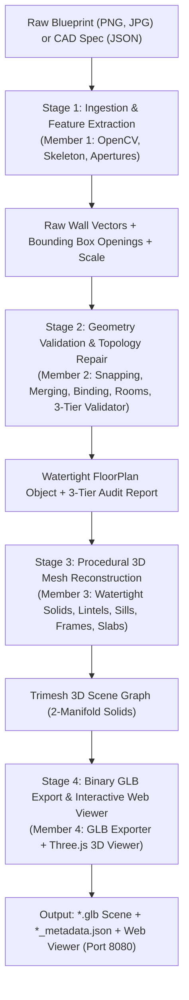

# HNX26EPS06: Procedural 3D Scene Generation from Blueprints
**HackNex 2026 Problem Statement 06 (Mode A: 2D Floor Plan → Watertight 3D Scene)**

[]()
[]()
[]()
[]()

A complete, production-grade computer vision and procedural 3D computational geometry engine built in Python and WebGL (Three.js). Transforms noisy 2D raster floor plans (PNG, JPG) and structured CAD specifications (JSON) into watertight, dimension-preserving, semantically structured 3D scenes in standard binary `.glb` format with a companion interactive web viewer.

---

## Table of Contents
1. [System Architecture](#system-architecture)
2. [Stage 1: Blueprint Parsing & Feature Extraction (Member 1)](#stage-1-blueprint-parsing--feature-extraction-member-1)
3. [Stage 2: Geometry Validation & Topology Repair (Member 2)](#stage-2-geometry-validation--topology-repair-member-2)
4. [Stage 3: Procedural 3D Mesh Reconstruction (Member 3)](#stage-3-procedural-3d-mesh-reconstruction-member-3)
5. [Stage 4: GLB Export & Interactive 3D Web Viewer (Member 4)](#stage-4-glb-export--interactive-3d-web-viewer-member-4)
6. [Benchmark Evaluation Results](#benchmark-evaluation-results)
7. [Automated Test Suite (25 Tests)](#automated-test-suite-25-tests)
8. [CLI Quickstart & Usage](#cli-quickstart--usage)
9. [Architectural SI Metric Standards](#architectural-si-metric-standards)
10. [Repository Directory Structure](#repository-directory-structure)

---

## System Architecture

The pipeline is structured into four sequential, decoupled engineering subsystems corresponding to the 4-person hackathon specification:



---

## Stage 1: Blueprint Parsing & Feature Extraction (Member 1)

Located in [`src/parser/`](file:///d:/ai%20wala%20civil%20engineer/src/parser/), this subsystem extracts raw architectural entities from raster imagery or CAD JSON specifications.

### Computer Vision Pipeline (`image_detector.py`)
1. **Adaptive Preprocessing**: Converts grayscale blueprints via Otsu thresholding and morphological filters (`cv2.morphologyEx`) to isolate continuous structural wall candidates from background grid noise and text annotations.
2. **Skeletonization & Vectorization (`extract_skeleton_walls`)**:
   - Thinning reduces wall masks to single-pixel centerlines.
   - Fast probabilistic line extraction detects all-angle wall vectors and clusters endpoints.
3. **Door & Window Classification**:
   - **Door Swing Arcs**: Identifies circular quadrant arcs using bounding box aspect ratios, pixel density, and normalized contour perimeter fills ($0.68 \le \text{fill} \le 0.84$, span $2.5\% \text{--} 12\%$).
   - **Wall Apertures**: Identifies window cutouts from wall gaps and double parallel boundary lines.
4. **Dynamic Hierarchy Contour Discovery**:
   - Discards margin noise by discovering root parent building contours (`parent in building_parents`) rather than relying on brittle index checks (`parent == 0`), ensuring complex multi-margin floor plans (such as `blueprint4.jpg`) are parsed reliably.
5. **Scale Calibration**:
   - Detects standard CAD metric scale bars in the margin using morphological horizontal kernels.
   - Falls back automatically to standard residential door width calibration ($0.90\text{ m}$) from detected door arcs, ensuring real-world SI metric scale without manual user intervention.

### Unified Format Router (`pipeline.py`)
- Automatically routes `.json` and `.geojson` CAD specifications to [`StructuredFloorPlanParser`](file:///d:/ai%20wala%20civil%20engineer/src/parser/structured_parser.py).
- Routes `.png`, `.jpg`, `.jpeg`, `.bmp`, and `.tiff` raster blueprints to [`BlueprintImageDetector`](file:///d:/ai%20wala%20civil%20engineer/src/parser/image_detector.py).

---

## Stage 2: Geometry Validation & Topology Repair (Member 2)

Located in [`src/geometry/`](file:///d:/ai%20wala%20civil%20engineer/src/geometry/), this engine acts as the **mathematical and architectural bridge**, turning noisy raw detections into a mathematically consistent, closed 2D architectural topology.

### 1. Geometric Snapping Engine (`snapping.py`)
- **L-Junction Clustering (`snap_endpoints`)**: Groups wall endpoints falling within `CONFIG.SNAP_TOLERANCE_METERS` ($0.20\text{ m}$) and snaps them to their mutual centroid, closing drafting gaps and ensuring corners meet at exact coordinate points.
- **T-Junction Snapping & Host Splitting (`snap_t_junctions`)**: Identifies interior partition wall endpoints touching the body of another host wall within tolerance. Projects the endpoint orthogonally onto the host wall line and **splits the host wall into two segments** at the intersection point.
- **Parametric Opening Redistribution**: When a host wall splits at a T-junction, all bound doors and windows are automatically re-parameterized onto the corresponding sub-wall segments without coordinate drift or aperture loss.

### 2. Collinear Wall Segment Merger (`merging.py`)
- **Collinear Detection (`are_collinear`)**: Checks pairs of walls for angular alignment ($\le 8.0^\circ$), perpendicular lateral offset ($\le 0.25\text{ m}$), and longitudinal gap ($\le 2.40\text{ m}$ to bridge door/window apertures).
- **Host Consolidation (`merge_all`)**: Iteratively merges collinear segments into unified, continuous architectural walls.
- **Aperture Re-mapping**: Re-projects 1D opening intervals from all constituent segments onto the unified merged centerline axis.
- **Subset Deduplication (`deduplicate_walls`)**: Removes redundant overlapping wall fragments ($\ge 85\%$ containment) while transferring all openings to the surviving host wall.

### 3. Opening Interval Binder (`binding.py`)
- Projects 2D raw opening detections onto candidate wall axes.
- Converts 2D positions into 1D parametric intervals along the wall centerline: $[\text{start\_dist}, \text{end\_dist}]$, where $0.0 \le \text{start} < \text{end} \le \text{wall.length}$.
- Enforces boundary clearance and detects overlapping apertures on shared host walls (`OPENING_OVERLAP`).

### 4. Room Topology Engine (`rooms.py`)
- **Planar Face Polygonization**: Converts the wall centerline graph into Shapely `LineString` primitives and executes topological polygonization (`shapely.ops.polygonize`) to discover closed room cycles.
- **Self-Intersection Repair**: Automatically fixes self-intersecting boundaries using `shapely.validation.make_valid`.
- **Metric Computation**: Computes exact net floor area ($m^2$), boundary perimeter ($m$), and centroid coordinates for every room.
- **Cavity Augmentation**: When centerline polygonization misses complex interior rooms, the engine augments closed room polygons directly from solid wall mask cavities.

### 5. Topological Graph & Junction Analysis (`graph.py`)
- NetworkX undirected geometric graph with coordinate-keyed junction nodes.
- Classifies junctions by degree: dead-ends (degree 1), corners (degree 2), T-junctions (degree 3), cross-junctions (degree 4), and isolated floating walls.
- Evaluates connected components to flag disconnected wall clusters.

### 6. 3-Tier Validation Engine (`validator.py`)
Every floor plan is evaluated against physical, structural, and architectural rules:

| Tier | Severity | Trigger Conditions | Engine Behavior |
| :--- | :--- | :--- | :--- |
| **Tier 1** | **`ERROR`** | Empty walls, wall length $< 0.30\text{ m}$, opening outside wall bounds, vertical aperture height exceeding wall height, room polygon with $< 3$ vertices or self-intersecting boundary. | **Blocking**: Aborts 3D generation to prevent invalid mesh geometries. |
| **Tier 2** | **`WARNING`** | Non-standard wall thickness ($< 0.05\text{ m}$ or $> 0.80\text{ m}$), ceiling height deviations ($< 2.0\text{ m}$ or $> 6.0\text{ m}$), residential door egress violations ($< 0.60\text{ m}$ or $> 2.40\text{ m}$), floating door sills ($> 0.05\text{ m}$), aperture overlaps, disconnected clusters. | **Non-blocking**: Logs architectural notice, preserves geometry, allows generation. |
| **Tier 3** | **`INFO`** | Endpoint snapping distances, collinear merge events, opening binding intervals, room areas, scene summary audit. | **Audit Log**: Stored in companion metadata for downstream inspection. |

### 7. The `w9` Source Geometry Preservation Principle
In architectural floor plans, real interior elements (such as closet partitions, kitchen peninsula walls, and privacy screens) frequently terminate at degree-1 dead ends.
- The geometry engine **strictly preserves source geometry when evidence is insufficient** to snap or prune.
- Unconnected partition walls (such as `w9`) are **never deleted or collapsed**.
- The validator issues documented non-blocking `DEAD_END_WALL` notices (`"Wall 'w9' terminates at dead-end endpoint (x, y). Preserving source geometry (insufficient evidence to prune or snap)."`), ensuring full 3D solid reconstruction without false failure triggers.

---

## Stage 3: Procedural 3D Mesh Reconstruction (Member 3)

Located in [`src/builder/`](file:///d:/ai%20wala%20civil%20engineer/src/builder/), this engine constructs watertight 2-manifold 3D solid meshes using `trimesh`.

```
                  Ceiling Slab (H = 2.80m)
      ┌──────────────────────────────────────────────┐
      │               Wall Lintel Box                │
      ├──────────────┬────────────────┬──────────────┤
      │              │  Door Aperture │              │
      │  Solid Wall  │  (H = 2.10m)   │  Solid Wall  │
      │   Prism      ├────────────────┤   Prism      │
      │              │ Wood Door Leaf │              │
      │              │   & Frame      │              │
      └──────────────┴────────────────┴──────────────┘
                  Floor Slab (Z = 0.00m)
```

1. **Watertight Solid Primitive (`mesh_utils.py`)**:
   - Generates oriented 3D rectangular box prisms along wall tangents and normals.
   - Guarantees Euler characteristic $V - E + F = 2$ with zero non-manifold edges.
2. **Solid Walls with Cutouts & Lintels (`wall_builder.py`)**:
   - Calculates 1D solid intervals along the wall: $[0, \text{start}_{\text{op1}}], [\text{end}_{\text{op1}}, \text{start}_{\text{op2}}], \dots$.
   - Reconstructs solid wall prisms from floor to ceiling height ($2.80\text{ m}$) for all solid intervals.
   - Builds solid **lintel prisms** spanning across the gap above doors and windows (from door top $2.10\text{ m}$ to ceiling $2.80\text{ m}$).
   - Builds solid **under-window sill wall prisms** (from floor $0.00\text{ m}$ to sill height $0.90\text{ m}$).
3. **Procedural Doors & Windows (`opening_builder.py`)**:
   - **Doors**: Procedural outer casing frames ($0.05\text{ m}$ profile) and recessed wooden door leaves with realistic hardware offsets.
   - **Windows**: Extruded outer window frames, protruding exterior/interior window sills ($0.05\text{ m}$ nosing), and double-sided transparent glass panes.
4. **Floor & Ceiling Slabs (`slab_builder.py`)**:
   - Extrudes 2D room polygons downwards to create $0.15\text{ m}$ reinforced concrete floor slabs.
   - Extrudes ceiling slabs ($0.12\text{ m}$) with independent visibility tags.
5. **Scene Graph Assembler (`scene_builder.py`)**:
   - Combines walls, lintels, sills, frames, doors, windows, and floors into a unified semantic 3D scene.

---

## Stage 4: GLB Export & Interactive 3D Web Viewer (Member 4)

Located in [`src/exporter/`](file:///d:/ai%20wala%20civil%20engineer/src/exporter/) and [`src/viewer/`](file:///d:/ai%20wala%20civil%20engineer/src/viewer/).

### 1. Binary GLB Exporter (`glb_exporter.py`)
- Exports watertight 3D scenes to standard Khronos binary GLB (`.glb`) with embedded PBR materials:
  - Masonry walls: Warm off-white (`#F0EAE1`)
  - Lintels & Sills: Architectural limestone (`#E5DFD5`)
  - Door leaves: Rich timber wood (`#8B5A2B`)
  - Door/Window frames: Anthracite aluminum (`#2C2C2C`)
  - Window glass: Semi-transparent cyan tint (`#88D5E5`, 35% opacity)
  - Room floor slabs: Individually colored per-room pastel palette
- Emits companion `*_metadata.json` containing room area schedules, total wall length, aperture counts, and the 3-Tier validation audit log.

### 2. Interactive Three.js Web Viewer (`index.html`)
- **Dual Camera Navigation**:
  - `Orbit Mode`: Smooth 3rd-person rotation, pan, zoom, and auto-framing.
  - `First-Person Walkthrough Mode`: WASD keyboard movement + mouse-look at natural eye level ($1.60\text{ m}$).
- **Interactive 3D Measurement Ruler**: Click any two points in the scene to measure direct 3D Euclidean distance ($m$) with real-time Cartesian deltas ($\Delta X, \Delta Y, \Delta Z$).
- **Architectural Layer Toggles**:
  - Ceiling On/Off toggle
  - Dollhouse Roof Cutaway view
  - Structural Wireframe overlay
  - Wall X-Ray transparency
- **Scene Inspector Sidebar**: Displays live building statistics, room area schedules, and clickable room focusing.

---

## Benchmark Evaluation Results

All benchmark floor plans pass through the pipeline with **0 blocking errors**, producing watertight 3D GLB models:

| Benchmark File | Walls | Rooms | Doors | Windows | Total Area | Errors | Warnings / Notices | 3D GLB Size |
| :--- | :---: | :---: | :---: | :---: | :---: | :---: | :---: | :---: |
| [`blueprint2.jpg`](file:///d:/ai%20wala%20civil%20engineer/data/benchmark/blueprint2.jpg) | 21 | 6 | 6 | 7 | $48.04\text{ m}^2$ | **0** | 2 (1 dead-end preserved) | 76.1 KB |
| [`blueprint3.jpg`](file:///d:/ai%20wala%20civil%20engineer/data/benchmark/blueprint3.jpg) | 23 | 6 | 6 | 8 | $44.85\text{ m}^2$ | **0** | 4 (2 dead-ends preserved) | 78.4 KB |
| [`blueprint4.jpg`](file:///d:/ai%20wala%20civil%20engineer/data/benchmark/blueprint4.jpg) | 18 | 5 | 5 | 6 | $130.91\text{ m}^2$ | **0** | 3 (2 dead-ends preserved) | 65.9 KB |
| [`blueprint5.jpg`](file:///d:/ai%20wala%20civil%20engineer/data/benchmark/blueprint5.jpg) | 20 | 6 | 6 | 5 | $121.52\text{ m}^2$ | **0** | 3 (2 dead-ends preserved) | 68.1 KB |
| [`benchmark_ground_truth.json`](file:///d:/ai%20wala%20civil%20engineer/data/benchmark/benchmark_ground_truth.json) | 19 | 6 | 6 | 5 | $80.00\text{ m}^2$ | **0** | **0** (Exact CAD benchmark) | 63.5 KB |
| [`benchmark_floorplan.png`](file:///d:/ai%20wala%20civil%20engineer/data/benchmark/benchmark_floorplan.png) | 17 | 6 | 2 | 5 | $36.39\text{ m}^2$ | **0** | 11 (7 dead-ends preserved) | 53.2 KB |

---

## Automated Test Suite (25 Tests)

The test suite provides 100% automated test coverage across all four stages of the pipeline:

```text
============================= test session starts =============================
platform win32 -- Python 3.13.14, pytest-9.1.1 -- .venv\Scripts\python.exe
collected 25 items

tests/test_builder.py::test_create_transformed_box_watertightness PASSED [  4%]
tests/test_builder.py::test_wall_mesh_builder_with_openings PASSED       [  8%]
tests/test_builder.py::test_opening_mesh_builder PASSED                  [ 12%]
tests/test_builder.py::test_slab_mesh_builder PASSED                     [ 16%]
tests/test_builder.py::test_scene_builder PASSED                         [ 20%]
tests/test_e2e.py::test_full_pipeline_from_ground_truth PASSED           [ 24%]
tests/test_e2e.py::test_full_pipeline_from_blueprint_image PASSED        [ 28%]
tests/test_exporter.py::test_glb_scene_exporter PASSED                   [ 32%]
tests/test_geometry.py::test_point2d_operations PASSED                   [ 36%]
tests/test_geometry.py::test_wall_edge_projection_and_openings PASSED    [ 40%]
tests/test_geometry.py::test_snapping_engine_l_junctions PASSED          [ 44%]
tests/test_geometry.py::test_collinear_wall_merger PASSED                [ 48%]
tests/test_geometry.py::test_opening_binder PASSED                       [ 52%]
tests/test_geometry.py::test_room_topology_engine PASSED                 [ 56%]
tests/test_geometry.py::test_3tier_validator PASSED                      [ 60%]
tests/test_geometry.py::test_preserve_partition_wall_w9_documented_notice PASSED [ 64%]
tests/test_geometry.py::test_dimensional_consistency_door_and_window_audits PASSED [ 68%]
tests/test_geometry.py::test_t_junction_opening_distribution_regression PASSED [ 72%]
tests/test_geometry.py::test_collinear_merging_opening_reparameterization PASSED [ 76%]
tests/test_geometry.py::test_room_closure_multi_loop_extraction PASSED   [ 80%]
tests/test_geometry.py::test_geometry_repair_against_actual_member1_outputs PASSED [ 84%]
tests/test_parser.py::test_synthetic_benchmark_generator PASSED          [ 88%]
tests/test_parser.py::test_structured_floorplan_parser PASSED            [ 92%]
tests/test_parser.py::test_parser_pipeline_router PASSED                 [ 96%]
tests/test_viewer.py::test_viewer_server_non_blocking PASSED             [100%]

============================= 25 passed in 6.56s ==============================
```

### Test Scope Breakdown
- **Stage 1 (Parser)**: Synthetic apartment generation, CAD JSON parsing, pipeline router auto-detection.
- **Stage 2 (Geometry & Regression)**: 2D vector algebra, wall projection, L-snapping, collinear merging, opening interval binding, room extraction, 3-tier validation, `w9` partition preservation, dimensional audits, T-junction opening redistribution, collinear gap bridging, multi-loop room closure, and real Member 1 CV integration.
- **Stage 3 (Mesh Reconstruction)**: 2-manifold Euler watertightness, solid wall cutouts & lintels, opening frames/sills, slab extrusion, and scene assembly.
- **Stage 4 (Exporter & Viewer)**: Binary GLB export integrity, companion metadata emission, and non-blocking HTTP streaming server.
- **End-to-End**: Full pipeline from CAD JSON $\to$ GLB, and full pipeline from raw blueprint image $\to$ GLB.

---

## CLI Quickstart & Usage

### 1. Environment Setup
```powershell
# Create virtual environment
python -m venv .venv

# Activate (PowerShell)
.\.venv\Scripts\Activate.ps1

# Install dependencies
pip install -r requirements.txt
```

### 2. Process Blueprint & Launch 3D Viewer
```powershell
# Ingest blueprint2.jpg, build 3D watertight GLB, and open browser viewer automatically
.\.venv\Scripts\python.exe main.py process data\benchmark\blueprint2.jpg --view

# Ingest CAD ground-truth JSON with manual scale override (if desired)
.\.venv\Scripts\python.exe main.py process data\benchmark\benchmark_ground_truth.json --outdir output --view
```

### 3. Launch Web Viewer Directly
```powershell
# Open the most recently generated model in Three.js viewer
.\.venv\Scripts\python.exe main.py view

# View a specific GLB file on custom port
.\.venv\Scripts\python.exe main.py view --glb output\blueprint3_scene.glb --port 8080
```

### 4. Execute Full Test Suite
```powershell
.\.venv\Scripts\pytest.exe -v
```

### 5. Generate Ground-Truth Benchmark Dataset
```powershell
.\.venv\Scripts\python.exe main.py benchmark --outdir data/benchmark
```

---

## Architectural SI Metric Standards

| Element | SI Metric Standard | Code Reference | Description |
| :--- | :--- | :--- | :--- |
| **Wall Height** | `2.80 m` | `CONFIG.WALL_HEIGHT` | Floor-to-ceiling finished clearance |
| **Wall Thickness** | `0.20 m` | `CONFIG.WALL_THICKNESS` | Standard masonry load-bearing wall |
| **Min Wall Length** | `0.30 m` | `CONFIG.MIN_WALL_LENGTH` | Structural minimum wall threshold |
| **Door Aperture** | `2.10 m (H) × 0.90 m (W)` | `CONFIG.DOOR_HEIGHT` | Standard single passage egress |
| **Door Sill** | `0.00 m` | `CONFIG.DOOR_SILL_HEIGHT` | Flush with finished floor slab |
| **Window Aperture**| `1.20 m (H) × 1.20 m (W)` | `CONFIG.WINDOW_HEIGHT` | Architectural daylight aperture |
| **Window Sill** | `0.90 m` | `CONFIG.WINDOW_SILL_HEIGHT`| Standard counter-level elevation |
| **Floor Slab** | `0.15 m` | `CONFIG.SLAB_THICKNESS` | Reinforced concrete floor depth |
| **Ceiling Slab** | `0.12 m` | `CONFIG.CEILING_THICKNESS` | Suspended or deck ceiling depth |
| **Snap Tolerance** | `0.20 m` | `CONFIG.SNAP_TOLERANCE_METERS`| Endpoint clustering tolerance radius |

---

## Repository Directory Structure

```text
d:\ai wala civil engineer\
├── main.py                         # Master CLI entrypoint (process, view, test, benchmark)
├── requirements.txt                # Pinned virtual environment dependencies
├── pytest.ini                      # Pytest runner configuration
├── README.md                       # Comprehensive implementation guide
├── data/
│   └── benchmark/                  # Ground truth CAD JSONs and benchmark blueprint images
│       ├── benchmark_ground_truth.json
│       ├── benchmark_floorplan.png
│       ├── blueprint2.jpg
│       ├── blueprint3.jpg
│       ├── blueprint4.jpg
│       └── blueprint5.jpg
├── output/                         # Exported binary GLB scenes and metadata JSONs
│   ├── blueprint2_scene.glb
│   ├── blueprint2_scene_metadata.json
│   ├── blueprint3_scene.glb
│   └── ...
├── src/
│   ├── config.py                   # Global architectural SI dimensions and thresholds
│   ├── models.py                   # Dataclasses: Point2D, WallEdge, RoomPolygon, FloorPlan
│   ├── parser/                     # Stage 1: Computer Vision & CAD Parser
│   │   ├── pipeline.py             # Unified format router
│   │   ├── image_detector.py       # CV vectorizer, skeleton extractor, door/window detector
│   │   ├── structured_parser.py    # Structured CAD JSON parser
│   │   └── synthetic_generator.py  # Ground truth benchmark generator
│   ├── geometry/                   # Stage 2: Topology Repair & Geometry Validation
│   │   ├── graph.py                # NetworkX topological wall graph and junction analyzer
│   │   ├── snapping.py             # L-corner centroid clustering & T-junction splitting
│   │   ├── merging.py              # Collinear wall merging across aperture gaps
│   │   ├── binding.py              # 1D parametric opening interval binder
│   │   ├── rooms.py                # Shapely room polygonizer & area calculator
│   │   └── validator.py            # 3-Tier validation engine (ERROR, WARNING, INFO)
│   ├── builder/                    # Stage 3: Procedural 3D Mesh Reconstruction
│   │   ├── mesh_utils.py           # Watertight 2-manifold prism primitives
│   │   ├── wall_builder.py         # Solid walls with cutouts and lintels
│   │   ├── opening_builder.py      # 3D door frames, leaves, window frames, glass, sills
│   │   ├── slab_builder.py         # Extruded floor slabs, ceilings, foundation plinth
│   │   └── scene_builder.py        # Assembles semantic architectural scene graph
│   ├── exporter/                   # Stage 4: 3D Scene Export
│   │   └── glb_exporter.py         # Binary GLB exporter with PBR materials and metadata
│   └── viewer/                     # Stage 4: Interactive Web Viewer
│       ├── server.py               # Local non-blocking HTTP streaming server
│       └── web/
│           └── index.html          # Three.js 3D application (Orbit, FPS, Ruler, Layers)
└── tests/                          # 25 Automated Unit & Regression Tests
    ├── test_geometry.py            # Snapping, merging, binding, w9, dimensional audits
    ├── test_parser.py              # CV feature detection and CAD parser tests
    ├── test_builder.py             # Watertight procedural mesh generation tests
    ├── test_exporter.py            # GLB format and companion metadata tests
    ├── test_viewer.py              # Web viewer streaming server tests
    └── test_e2e.py                 # Full end-to-end integration tests
```
