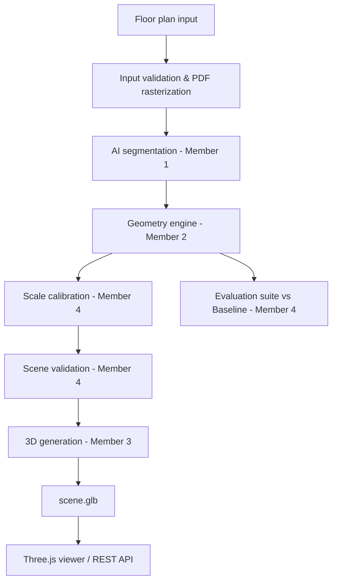

# Architecture Specification — HNX26EPS06 Mode A

## End-to-End Pipeline Architecture

## Component Breakdown

1. **Input Validation (`integration/validators.py`)**:
   - File existence and format validation (`.png`, `.jpg`, `.jpeg`, `.pdf`).
   - PyMuPDF rasterization for page 1 of PDFs at 200 DPI.
   - Low resolution detection (< 400px shorter side).

2. **AI Segmentation Adapter (`integration/adapters.py`)**:
   - Calls `ai.inference.analyze_floorplan` or falls back to `stub_analyze_floorplan`.
   - Sanitizes output masks into standard 2D `numpy uint8` arrays.

3. **Geometry Reconstruction Adapter (`integration/adapters.py`)**:
   - Calls `geometry.reconstruction.reconstruct_geometry` or falls back to `stub_reconstruct_geometry`.

4. **Scale Calibration Engine (`integration/scale.py`)**:
   - Explicit OCR dimension line extraction (EasyOCR / PyTesseract + Hough lines).
   - Reference door width calibration (0.90 m standard door).
   - Estimated wall thickness / building bounding box heuristic.
   - Origin normalization and meter scaling.

5. **Scene Topology Validator (`integration/validators.py`)**:
   - Checks wall coordinates, door positions, window sill heights, and room polygons (`shapely`).
   - Geometry quality counters: `invalid_walls`, `disconnected_walls`, `doors_without_wall`, `windows_without_wall`, `self_intersecting_rooms`.

6. **3D Extrusion Engine (`integration/stubs.py`)**:
   - Converts scene wall segments into 3D box meshes using `trimesh` and exports binary `.glb`.
